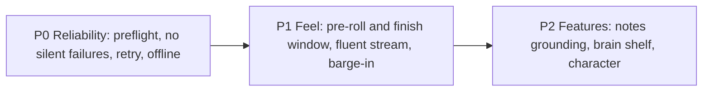

# Adeola vs. "Run Jarvis Fully Local" — Gap Analysis

**Source doc:** *Run Jarvis Fully Local* prompt pack (3 installs + 8 prompts, Mac-first).
**Codebase reviewed:** `adeola` @ `2b3311a` — `main.py`, `app/brain/*`, `app/audio/*`, `app/memory/store.py`, `app/tools/registry.py`, `config.py`, `requirements.txt`.

> [!NOTE]
> The two projects have different goals. The pack builds a **notes-grounded "second brain" in a browser** (3D galaxy, `/chat` over markdown). Adeola is a **Windows desktop command assistant** (apps, media, projects, memory) that runs in the terminal. The pack's *laws and lessons* carry over well. Its *product* (the galaxy viewer) mostly doesn't, so I've marked what to adopt and what to skip.

---

## 1. Scorecard, section by section

| Pack section | What the pack wants | Adeola today | Verdict |
|---|---|---|---|
| **Install 01 · Brain** | Ollama, silent thinking off (`reasoning_effort: none`), everything pinned | Ollama `qwen3:4b`, `think=False` + `/no_think` + fallback for models without thinking ([model.py](file:///c:/Users/O%20M%20E%20N/Downloads/adeola/app/brain/model.py#L97-L111)). Python deps use `>=`, so they aren't pinned | ✅ brain · ⚠️ pinning |
| **Install 02 · Voice** | VoiceStudio + CSM clone (Apple only), Apache-licensed weights | Kokoro ONNX on CPU, custom voice blend, Apache-2.0 weights, pinned release `v1.0` | ✅ Right choice for Windows |
| **Install 03 · Ears** | Whisper on your own machine, big model for commands, small one for the wake word | faster-whisper `base.en` on CPU; **openWakeWord** handles the wake word, so ordinary speech never gets transcribed | ✅ Better than the pack |
| **01 · Foundation** | OpenAI-style client that can talk to any provider; system prompt stable and first; ≥600 max tokens; **retry once with a bigger budget if the reply comes back empty** | Stable system prompt first ✅, history → facts → user last ✅. Uses the `ollama` SDK only. `MAX_OUTPUT_TOKENS=150` with **no retry**: a long chat reply cut off at 150 tokens is broken JSON, and she says "I lost my train of thought" ([model.py](file:///c:/Users/O%20M%20E%20N/Downloads/adeola/app/brain/model.py#L135-L140)) | ⚠️ Gap |
| **02 · Voice** | Chunks packed by sentence, prefetch during playback, **never cut the first chunk short**; disk cache; keep the engine warm; fall back to another voice and never go silent | Prefetch during playback ✅, disk cache ✅, idle prewarm ✅ (better than the pack). **But** [`speech_chunks`](file:///c:/Users/O%20M%20E%20N/Downloads/adeola/app/audio/tts.py#L83-L99) deliberately splits at commas (`max_words=10`), which is exactly what pack lesson #4 warns against. Each chunk gets its own `sd.play()` call, which reopens a stream and can leave small gaps or clicks. If Kokoro fails there is no fallback voice, only text | ⚠️ Gap (fluency) |
| **03 · Ears** | Silence window + **finish window** (handles pauses mid-sentence); throw away anything without the wake word; "Yes?" when only the name is heard; **"stop"/"wait" interrupts while she's talking**; status line | Wake word + PTT ✅, non-wake audio discarded ✅, beeps/status ✅. One `END_SILENCE_SECONDS=0.8` and **no finish window**, so a pause longer than 0.8 s cuts the command off. **No pre-roll buffer**: capture only starts after the wake word is detected, so the start of "Adeola **op**en Brave" can be lost. **No voice barge-in**: the wake word is ignored while she speaks ([wake.py](file:///c:/Users/O%20M%20E%20N/Downloads/adeola/app/audio/wake.py#L92-L101)), so only the key can stop her | ⚠️ Gap (feel) |
| **04 · Character** | Persona under 300 words, stable prefix, receipts law, control tags tested 5×, boot greeting with real counts | Receipts law ✅ (when tools run, the model's prose is thrown away, so receipts are enforced in the code itself). [eval_commands.py](file:///c:/Users/O%20M%20E%20N/Downloads/adeola/tests/eval_commands.py) scores 20 commands ✅ (better than 5×). Boot line shows real app/project/fact counts ✅. Personality is thin: one generic line, and fast-path replies are always the same ("Hey! What can I do for you?") | 🟡 Opportunity |
| **05 · Total recall** | "remember that" → a real markdown file, searchable straight away; answers point to their source; **a capture must never fail silently** | remember/recall/forget/keep-or-skip ✅ (richer than the pack). SQLite instead of markdown. **Bug:** [`Toolbox.run`](file:///c:/Users/O%20M%20E%20N/Downloads/adeola/app/tools/registry.py#L227-L230) only catches `OSError`. A `sqlite3.Error` (for example a locked DB) or a winrt media error escapes `Router.handle`'s fast path ([router.py](file:///c:/Users/O%20M%20E%20N/Downloads/adeola/app/brain/router.py#L183)) and **crashes the typing loop**, or kills the voice thread without a word | 🔴 Bug |
| **06 · Switch** | A named "brain shelf", spoken "switch to X" / "which brain are you on", a badge, "one moment" while a model loads, cloud kept optional | You pick the model once at startup with `--model`. No shelf and no spoken switching. Voice blend is fixed at boot | ⚠️ Gap |
| **07 · Preflight** ⭐ | One script that runs every **live** chain end to end, with ✓/✗/WARN, a **latency budget** (hear/think/speak), a **TTS→STT loop**, a capture round-trip, and a non-zero exit on failure | Unit tests (mocked) + eval (dry run) + `mic_check` + `wake_check`, all separate. **Nothing proves the real chain works**, and there's no hear/think/speak budget | 🔴 Biggest gap |
| **08 · Wi-Fi-off drill** | Prove that nothing leaves the machine; log outbound hosts during a turn; list the features that honestly need the internet | Runtime is local ✅. But `WhisperModel("base.en")` calls `snapshot_download` with `local_files_only=False` ([faster_whisper/utils.py](file:///c:/Users/O%20M%20E%20N/Downloads/adeola/.adenv/Lib/site-packages/faster_whisper/utils.py#L52)), so **every start contacts huggingface.co**, which slows startup when you're offline. openWakeWord and Kokoro skip files that already exist ✅. Nothing records outbound hosts. `web_search`/`open_url` need the internet by design and aren't listed as such | ⚠️ Gap |

---

## 2. What Adeola already does better than the pack (keep these)

- **Fast-path router**: common commands take ~0 ms and never touch the model. The pack sends everything to the LLM.
- **JSON-schema decisions** (`format=schema`): the model can't ramble, and the tool list is an enum.
- **openWakeWord**: a dedicated detector. The pack runs Whisper-small on *every* sound it hears.
- **Idle prewarm of likely replies**: goes further than the pack's single "Standing by." keep-warm.
- **Keep/skip offers, fading tips, activity log, project opener**: not in the pack at all.
- **Eval harness** with `--llm-only` / `--mode tools` comparisons.

## 3. What not to adopt

| Pack item | Why to skip it |
|---|---|
| VoiceStudio / CSM clone, mlx-whisper | Apple Silicon only. Kokoro and faster-whisper are the right picks on Windows |
| 3D galaxy web viewer | A different product. Revisit only alongside Phase 4 (FastAPI/Android), if ever |
| Butler persona word for word | Adeola should keep her own character. Take the *budget rules*, not the butler |
| `?mute=1` tab law | Browser-specific. Adeola's `--speak` / no-flag split already covers it |

---

## 4. Proposed roadmap (ranked by value ÷ effort)

### P0: reliability (small changes, big trust gain)
1. **`tools/preflight.py`** (Pack 07). Live checks: Ollama up + model pulled (prints the `ollama pull` command if not) → real `decide()` returns valid JSON with timing → Kokoro synth + time → **the loop**: Kokoro says a known sentence → resample 24 kHz→16 kHz → Whisper → word match → memory remember→recall→forget round-trip → wake model present (WARN if still on "hey jarvis") → mic present (WARN) → **offline check** (below). Ends with `LATENCY BUDGET: hear X s · think Y s · speak Z s` and `N pass · N fail · N warn`, exit code ≠ 0 on any fail.
2. **Never fail silently** (Pack 05). `Toolbox.run` catches *all* exceptions and returns a spoken "That didn't work: …", and the fast path in `Router.handle` is guarded the same way the model path already is. Add a test that injects a `sqlite3.OperationalError`.
3. **Retry on a truncated reply** (Pack 01). If `done_reason == "length"` or JSON parsing fails, retry once with a larger `num_predict` (e.g. 400). Keep 150 as the fast default.
4. **Offline hardening** (Pack 08). Once the Whisper model is cached, load it with `local_files_only=True`. Pin `requirements.txt` with `==`. Add an outbound-connection watcher (wrap `socket.create_connection`) that preflight uses to assert a local turn opens **zero** non-localhost connections. Print an "honest list" of features that need the internet (`web_search`, `open_url`, first-run downloads).

### P1: feel (voice quality)
5. **Wake pre-roll + finish window** (Pack 03). Keep a ~0.4 s ring buffer and put it in front of the capture. After `END_SILENCE` (0.8 s), **start transcribing straight away** while waiting a further `FINISH_SECONDS` (~0.7 s) for more speech; if you keep talking, append and start again. You can then pause mid-sentence without adding latency.
6. **Fluent playback** (Pack 02, lesson #4). One continuous `sd.OutputStream` fed from a queue, so there are no gaps between chunks. First, **measure** the gaps (log inter-chunk silence in ms with `-v`). Only change the comma-splitting if the numbers show gaps; the first chunk may stay a clause, but later chunks should be packed by sentence.
7. **Voice barge-in** (Pack 03). While she's speaking, keep the wake detector running at a higher threshold (e.g. 0.8) so "Adeola, stop" cuts her off. Warn in the README if speakers cause self-triggers (use headphones).
8. **Brain keep-warm** (Pack 02 idea). The model unloads after `KEEP_ALIVE=30m`. Optionally send a 1-token ping while idle so the first command after a break isn't a cold load. VRAM trade-off on a 4 GB GPU, so make it a config toggle.

### P2: features
9. **Notes grounding** (Pack 01/05 core). `NOTES_DIRS` in config (e.g. your Obsidian vault). Index `.md` files at boot with title-weighted keyword scoring (same as `Memory.search`), and pass the top 3 excerpts to the model for "what do my notes say about X". Optionally save "note to self …" captures as dated markdown files in a `captures/` folder.
10. **Brain & voice shelf** (Pack 06). `BRAINS = {"quick": "qwen3:1.7b", "smart": "qwen3:4b", …}` plus "switch to your smart brain", "which brain are you on", and "one moment" while a model loads. The same pattern works for voice blends ("use your calm voice").
11. **Character block** (Pack 04). A commented persona of 300 words or less at the top of `model.py`, plus 2–3 rotating variants for fast-path replies (greeting, "didn't catch that"). Add the honesty lines: "I run on this PC; I cost nothing" and "that needs the internet".
12. **More capture phrases** (Pack 05). Add "note to self", "log this", "don't let me forget" to `_REMEMBER`.

> [!IMPORTANT]
> I suggest doing P0 first, as one batch. Preflight then becomes the definition of "done" for everything after it, which is the pack's main point: *"Done" means preflight passed.*
